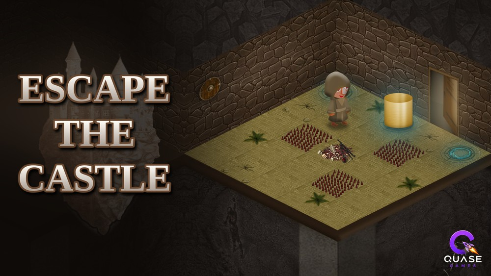

# Escape The Castle



Jogo de quebra-cabeça em visão isométrica da **Quase Games**, uma marca da **Quase Studios**. Você controla um monge preso em um castelo e precisa levar o totem até o medalhão certo para abrir a saída de cada sala.

- **Jogar:** https://escapethecastle.quasegames.com.br
- **Versão atual:** 1.1.0
- **Plataforma:** navegador, no computador e no celular
- **Tecnologia:** HTML5 Canvas e JavaScript puro, sem dependências, sem build e sem servidor

> *Grandes ideias começam com um quase.*

## Como jogar

1. **Empurre ou puxe o totem.** Ande contra ele para empurrar. Para puxar, ligue o Puxar, encoste no totem e ande para trás.
2. **Ache o medalhão certo.** Leve o totem até um medalhão. O certo acende em azul, e o totem vibra quando chega perto de um.
3. **Ative os outros medalhões.** Com o totem no lugar, clique ou toque nos demais. Quando todos acendem, a saída abre.

### Controles

| Computador | Celular e tablet | Ação |
|---|---|---|
| Setas ou W A S D | Direcional na tela | Andar, empurrar e puxar |
| Espaço | Botão Puxar | Ligar ou desligar o puxar |
| Clique no medalhão | Toque no medalhão | Ativar o medalhão |
| R | Botão Reiniciar | Recomeçar a sala |
| M | Botão de som no topo | Ligar ou desligar o som |
| Enter | Toque no botão | Confirmar nas telas de menu |

O direcional de toque aparece sozinho em celulares e tablets. Como a visão é isométrica, cada direção anda na diagonal da tela, e na primeira sala o chão mostra qual seta leva para cada lado.

### Regras

- O jogador tem 3 vidas por sala. Reiniciar a sala devolve as vidas.
- Estacas e cadáveres tiram 1 vida ao pisar. Ficar parado em cima tira mais uma a cada 1,5 segundo.
- O totem não atravessa estacas nem colunas, mas passa por cima de cadáveres.
- Estacas móveis sobem e descem a cada 2 passos do monge. Enquanto estão levantadas, machucam o monge e bloqueiam o totem.
- Se um totem sair do medalhão certo, os medalhões daquela etapa apagam.
- Se o totem não puder mais chegar ao medalhão certo, o jogo avisa para reiniciar a sala.

## As 10 salas

| Sala | Desafio | Solução mais curta sem levar dano |
|---|---|---:|
| 1 | Sala original do jogo: aprender a empurrar | 7 passos |
| 2 | Sala original, com quatro medalhões e cadáveres no centro | 9 passos |
| 3 | O totem começa contra a parede e precisa ser puxado | 5 passos |
| 4 | Colunas que bloqueiam o monge e o totem | 15 passos |
| 5 | Parede de estacas com uma só passagem | 8 passos |
| 6 | Estacas móveis | 7 passos |
| 7 | Dois totens e dois medalhões certos | 10 passos |
| 8 | Labirinto de colunas em que é obrigatório puxar | 17 passos |
| 9 | Dois totens e estacas móveis | 20 passos |
| 10 | Sala final com todos os desafios, em que é obrigatório puxar | 19 passos |

Depois de passar da primeira sala, o botão Start abre a tela de escolha de sala. O progresso, o recorde de passos de cada sala e a preferência de som ficam no navegador do jogador (`localStorage`, com as chaves `escapecastle.progresso`, `escapecastle.recordes` e `escapecastle.som`). Eles somem se a pessoa limpar os dados do site.

## Estrutura do repositório

```
EscapeTheCastle/
├── README.md
├── .gitignore
├── .gitattributes
├── capas/                 capas para o site e redes sociais (não vão para o ar)
│   ├── capa-site-1920x1080.jpg
│   ├── capa-site-1000x563.jpg
│   ├── capa-16x9.jpg
│   └── capa-1x1.jpg
└── public/                TUDO o que vai para o ar
    ├── index.html
    ├── favicon.png
    ├── apple-touch-icon.png
    ├── capa-16x9.jpg      imagem exibida ao compartilhar o link
    ├── _headers           cache das imagens, lido pela Cloudflare
    ├── css/style.css
    ├── js/game.js         todo o código do jogo
    └── assets/img/        cenários, ladrilhos, personagens e telas
```

Para criar ou alterar salas, edite a lista `ROOMS` em `public/js/game.js`. Cada sala é um mapa de texto de 5 por 5:

| Letra | Significado |
|---|---|
| `.` | Chão |
| `M` | Medalhão comum |
| `T` | Medalhão certo |
| `S` | Estacas |
| `C` | Cadáveres |
| `P` | Coluna |
| `A` e `B` | Estacas móveis, que se alternam |

A posição inicial do monge (`player`) e dos totens (`totems`) é definida junto com o mapa.

## Versões

O número segue esta regra:

- Correção de bug sobe o último número (1.1.1).
- Novidade grande, como novas fases, sobe o número do meio (1.2).
- Versão final ou mudança muito grande vai para 2.0.

### Histórico

- **1.1.0:** 10 salas, monge mais lento, comando de puxar, colunas, estacas móveis, dois totens, pista de proximidade, escolha de sala e progresso salvo.
- **1.0.1:** logo da Quase Games, nova tela de instruções, setas de ajuda na primeira sala e aviso de medalhão errado.
- **1.0.0:** primeira versão para navegador, com movimento por ladrilhos, novo sistema de dano, controles de toque, som, recordes e créditos.

## História do jogo

O Escape The Castle nasceu em 2020 como trabalho da disciplina de Processamento Gráfico da UNISINOS, com o professor Leandro Tonietto. A versão original foi escrita em C++ com OpenGL, GLFW e GLEW, a partir da base de estudos Sabertooth, de Rafael de Freitas (licença MIT).

Em 2026, o jogo foi reescrito do zero em JavaScript para rodar no navegador e entrar no catálogo da Quase Games. A arte do jogo original foi mantida. Em relação à versão de 2020, esta versão corrige:

- A velocidade, que dependia da potência do computador.
- O dano, que tirava todas as vidas em poucos segundos.
- O empurrão do totem, que saltava de um ladrilho para o outro e podia prendê-lo sem saída.
- Os botões Menu e Exit, que fechavam o jogo.
- A proporção achatada do personagem.

## Limitações conhecidas

- Ainda não foi testado no Safari do iPhone.
- A rotina de testes automáticos usada no desenvolvimento não faz parte deste repositório.

## Créditos

- **Criação e desenvolvimento:** Sander Gabriel dos Reis
- **Estúdio:** Quase Games, da Quase Studios
- **Disciplina de origem:** Processamento Gráfico, UNISINOS, com o professor Leandro Tonietto

Site: https://quasegames.com.br

## Direitos

© 2020-2026 Sander Gabriel dos Reis. Todos os direitos reservados.
